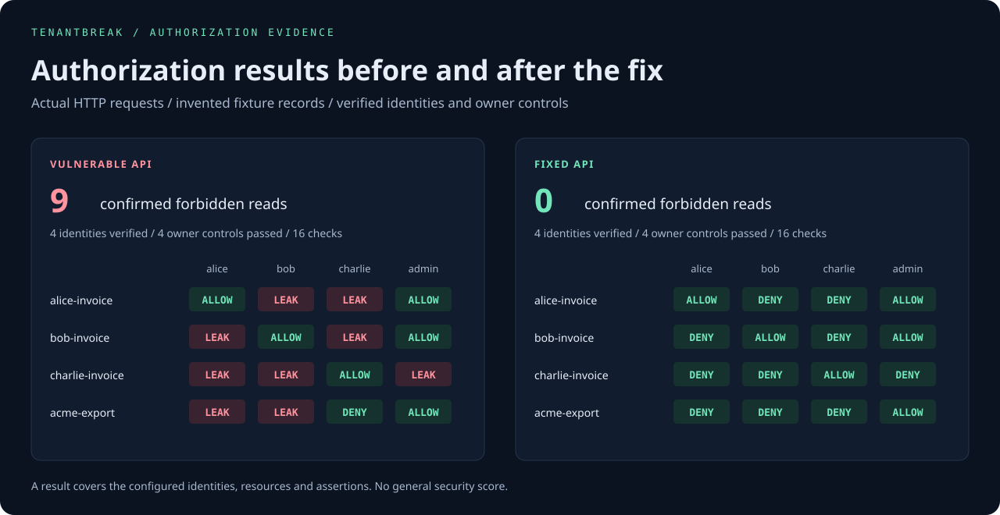

# TenantBreak

**Prove which users can read which API resources. Keep authorization bugs from coming back.**

TenantBreak runs an explicit access matrix across users, roles and tenants. A finding requires a verified identity, a successful owner control, and matching resource evidence in a forbidden response. A `200 OK` alone never establishes a leak.



[Vulnerable report](examples/vulnerable.html) · [Fixed report](examples/fixed.html) · [Run comparison](examples/comparison.html) · [Focused finding](examples/focused.html) · [Example policy](examples/policy.json)

## Try the complete experiment

Python 3.10+; the core engine has no runtime dependencies and needs no cloud account or API key. YAML import has an optional parser dependency.

```bash
git clone https://github.com/git-vac/tenantbreak.git
cd tenantbreak
python -m venv .venv
# Linux / macOS:
source .venv/bin/activate
# Windows PowerShell instead: .\.venv\Scripts\Activate.ps1
python -m pip install .

tenantbreak demo --html reports/vulnerable.html --json reports/vulnerable.json
tenantbreak demo --mode fixed --html reports/fixed.html --junit reports/fixed.xml
```

The first command exits **1**: it confirms **nine forbidden reads** in the bundled vulnerable API. The second exits **0**: all **six allowed and ten forbidden reads** match the same policy. Both commands make real HTTP requests to a temporary loopback server with entirely invented data. They close the server when finished.

Open the HTML files locally. Reports contain an access matrix, finding evidence, identity checks and owner controls. They work offline and load no scripts or remote assets.

The lab demonstrates three boundaries:

- **User:** Bob must not read Alice's private invoice.
- **Tenant:** Charlie from Nova must not read Acme's invoices.
- **Role:** Acme members must not retrieve its administrator export.

## Reproduce a finding and verify the fix

Focus a run on a resource, a principal, or an exact `RESOURCE:IDENTITY` case:

```bash
tenantbreak demo --case alice-invoice:bob --html reports/focused.html
tenantbreak run private/policy.json --resource alice-invoice --identity bob --json reports/focused.json
tenantbreak replay private/policy.json reports/focused.json --case alice-invoice:bob --html reports/replayed.html
```

Selectors are repeatable and intersect. Required identity checks and owner controls stay in the run even if their principals were not selected as probes. Only those accounts need environment credentials. Reports display the selected scope; omitted checks are **not run**, rather than passed.

`replay` uses the supplied matching policy and fresh environment credentials. It never sends requests to a target taken from the saved report. Without `--case`, it selects confirmed leaks recorded in that report. Use `--base-url` to override the current policy's target explicitly.

Compare two saved runs entirely offline:

```bash
tenantbreak demo --json reports/before.json
tenantbreak demo --mode fixed --json reports/after.json
tenantbreak compare reports/before.json reports/after.json --html reports/comparison.html --junit reports/comparison.xml
```

The first demo intentionally exits 1; run the next commands after observing that expected finding. The comparison establishes nine resolved leaks and exits 0. For an application, save JSON from `run` before and after its fix with the **same selected cases**. A focused replay of a full report has a smaller scope and cannot be compared directly with that full report.

Changed policies, case selections, definitions, execution limits, or demo/application modes prevent misleading comparisons. Different application target origins also require `--allow-target-change`; this acknowledges the change without establishing deployment equivalence. Temporary ports for the same bundled demo fixture are handled automatically. Version 0.1 reports can be loaded for replay, but comparison requires fresh version 0.2 evidence.

Comparison exits: **0** complete compatible evidence with no new or persistent leaks in the after run; **1** new or persistent leaks remain; **2** incomplete or incompatible evidence. [Replay and comparison details](docs/workflows.md).

## Build a policy for your application

Start from a scaffold or a local OpenAPI document:

```bash
tenantbreak init --base-url https://staging.example.test --out private/policy.draft.json
# Alternatively, import selected GET routes:
tenantbreak import-openapi examples/openapi.json --base-url http://127.0.0.1:8080 --operation readInvoice --out private/imported.draft.json
```

Edit the draft's `policy` object: resolve resource identifiers, configure identity verification, declare allowed identities, and supply specific resource evidence. Then produce a runnable policy:

```bash
tenantbreak finalize private/policy.draft.json --out private/policy.json
tenantbreak validate private/policy.json
```

Setup commands make no API requests. Drafts are deliberately blocked by `run` until finalized. The importer extracts GET routes from OpenAPI 3.0, 3.1 and 3.2 JSON or YAML documents; it does not infer business permissions or copy credential/response examples. Supply the target origin explicitly and use `--path-prefix /v1` for a version prefix. Narrow large specifications with repeatable `--operation` or `--path` selectors.

For YAML, install the optional extra from this checkout:

```bash
python -m pip install ".[openapi]"
tenantbreak import-openapi examples/openapi.yaml --base-url http://127.0.0.1:8080 --operation readInvoice --out private/yaml.draft.json
```

Local references are resolved within bounded limits; external references are never fetched. Authentication headers/cookies must be configured explicitly; request bodies and collection semantics still need application-specific review. [Policy setup walkthrough](docs/onboarding.md) · [Generated draft](examples/policy.draft.json).

## Configure authentication

Bearer tokens, custom headers and session cookies are supported per identity. Values come from environment variables or a private credential file. Existing `token_env` policies continue to work. To try the alternatives:

```bash
tenantbreak demo --auth headers --mode fixed
tenantbreak demo --auth cookies --mode fixed
```

Bearer accounts may also configure a same-origin OAuth refresh-token endpoint. Refresh is opt-in, runs once before identity verification and saves returned credentials privately, including rotations:

```bash
tenantbreak run private/policy.json --refresh-auth --refresh-out private/refreshed.json --json reports/access.json
```

Credentials stay fixed during access probes. An expired session remains a test error. [Authentication configuration and refresh workflow](docs/authentication.md) includes complete policy examples, client authentication options and private credential reuse.

## Test your own API

Use an API and test accounts you are authorized to examine. Start with staging fixtures whose ownership is known.

1. Complete a draft as above, or adapt [examples/policy.json](examples/policy.json) with your target origin, identity checks, paths, ownership evidence and allowed identities.
2. Set each test account's credentials in its configured environment variables. Values are never placed in the policy or a CLI argument.
3. Validate and run the policy:

```bash
tenantbreak validate private/policy.json
tenantbreak run private/policy.json --html reports/audit.html --json reports/audit.json --junit reports/audit.xml
```

`validate` checks structure without credentials or network requests. `run` checks the required identities against the configured identity endpoint, establishes an allowed control for each selected resource, and exercises the selected identity/resource combinations. Without selectors it runs the complete matrix.

For a disposable target with a changing port:

```bash
tenantbreak run private/policy.json --base-url https://staging.example.test --timeout 5 --max-seconds 120
```

The origin must have no path, embedded credentials, query or fragment. Resource paths are absolute paths on that origin. HTTPS is required outside loopback unless you explicitly use `--allow-http`. Redirects are refused and ambient proxy settings are ignored. Corporate proxies and custom authentication flows need an integration change.

## Declare access and evidence

Each resource names an explicit set of allowed identities. Every other configured identity is expected to be denied. Tenant and role labels help explain findings; they do not infer permissions.

```json
{
  "id": "alice-invoice",
  "label": "Alice's private invoice",
  "tenant": "acme",
  "path": "/api/invoices/inv-a104",
  "allow": ["alice", "admin-acme"],
  "control_identity": "alice",
  "match": {
    "/id": "inv-a104",
    "/tenant": "acme",
    "/marker": "TB-FIXTURE-ALICE-104"
  }
}
```

`match` uses JSON Pointer equality checks. Choose identifying values that prove the protected resource was returned, such as its ID, tenant and a unique fixture marker. Generic fields such as `success: true` are weak evidence. TenantBreak requires at least two assertions, but their meaning and specificity remain the policy author's responsibility. Assertion values are omitted from reports.

Identity `verify` assertions should independently check the authenticated subject, tenant and role. At least two fields are required, and each identity must have distinct verification assertions and distinct request credentials. Credential values must stay separate from policy text and evidence labels; collisions are refused so redaction cannot corrupt account/case identifiers.

## Interpret outcomes

| Result | Meaning |
| --- | --- |
| `confirmed-leak` | An expected-deny response matched **every** configured resource assertion, after identity and owner verification. Even a 403 containing the complete protected record is a leak. |
| `allowed` | Expected access returned HTTP 200 and all resource assertions matched. |
| `denied` | Expected-deny response returned 403/404 without matching protected resource assertions. Non-JSON denials are accepted by status only. |
| `inconclusive` | A control failed, only some evidence matched, an expected resource was absent, or the response did not establish access or denial. |
| `error` | Authentication expired, a redirect was refused, the API failed, JSON was malformed, or a transport limit was reached. |

An expired token, missing resource, login redirect or generic HTTP 200 error page cannot produce a clean passing run. JSON evidence is exact and structural: fields outside the configured assertions, encoded data and non-JSON response contents are not assessed for leakage.

Exit **0**: all configured checks matched policy. Exit **1**: confirmed leak(s), with complete controls/results. Exit **2**: error or incomplete evidence, including when leaks were also observed; those findings remain in the report. Exit **130**: interrupted.

## Put the policy in CI

```bash
tenantbreak run private/policy.json --json reports/access.json --junit reports/access.xml
```

Configure your CI runner to provide tokens through its secret environment mechanism and to collect artifacts even when the command fails. JUnit includes identity checks, owner controls and access probes: leaks are failures; missing evidence is an error. Preserve TenantBreak's nonzero exit status.

The repository's [CI workflow](.github/workflows/tests.yml) installs the package and runs real loopback integration tests on Linux and Windows. Lab credentials are generated in memory at runtime and omitted from published examples.

## Scope and limits

Resource tests use explicit **GET requests**, bearer/header/cookie credentials, HTTP 200 owner controls, 403/404 denials and JSON equality assertions. Optional pre-run OAuth refresh makes a bounded POST to the configured same-origin token endpoint; it does not add resource write testing. The setup tools create drafts from local OpenAPI documents or a starter template. Access rules and ownership evidence require explicit configuration. The runner does not discover accounts, enumerate IDs, change resource state or automate browser logins.

Every policy is limited to 32 identities, 64 resources and 16 assertions per identity/resource. Policy JSON and responses are bounded to 1 MiB, saved reports to 16 MiB, and OpenAPI input to 8 MiB. Requests run sequentially. The socket timeout defaults to 5 seconds; a 120-second run budget is checked before requests and between response chunks. A blocking operation can overrun that budget by up to its socket timeout, and OS DNS resolution may take longer. Results are observations over time, not an atomic snapshot.

Reports omit raw bodies, headers and cookies and redact exact supplied/returned credential values. Encoded/transformed values are not a general redaction guarantee. Paths, tenant labels and response digests can still describe your application. Saved reports are structurally checked and their outcomes recomputed before replay/comparison; they are not authenticated attestations. Refresh snapshots contain credentials and must stay private. `reports/`, `private/` and `.env*` are Git-ignored. Output files must be new; existing files and symlink targets are refused.

## Develop and extend

```bash
python -m pip install -e .
python -m unittest discover -s tests -v
```

[Architecture and evidence](docs/evidence.md) explains the decision rules. [Manual lab walkthrough](docs/lab.md) lets you test the CLI against a separate running API. Install `.[openapi]` to include optional YAML tests; the core tests run without it.

Related work: [AuthMatrix](https://github.com/SecurityInnovation/AuthMatrix) provides authorization matrices inside Burp Suite. TenantBreak focuses on an explicit standalone policy, evidence checks and CI results. Background: [OWASP broken object-level authorization](https://owasp.org/API-Security/editions/2023/en/0xa1-broken-object-level-authorization/) and [JSON Pointer, RFC 6901](https://www.rfc-editor.org/rfc/rfc6901).

MIT licensed.
