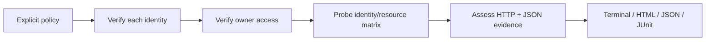

# How TenantBreak reaches a conclusion

## The policy is the authority

An identity has a subject label, tenant label, role label, token environment variable and JSON Pointer assertions for the configured identity endpoint. A resource has a path, explicit allow list, an allowed control identity and evidence assertions. The labels explain the matrix; only the allow lists determine expected permissions.

No access rule is guessed from a URL, role name, API specification or language model. An incorrect policy can generate an incorrect finding. In particular, a resource intended to be shared should list every permitted test identity.

## Controls come before probes

The engine verifies each identity with `GET identity_check.path` and requires HTTP 200 plus every identity assertion. It then retrieves each resource as its configured owner/control identity, requiring HTTP 200 and every resource assertion.

An invalid identity prevents probes for that identity. An invalid resource control prevents every matrix probe for that resource. These cases are recorded as inconclusive rather than omitted or passed. Other valid resources and identities still run.

## Evidence has a narrow meaning

A confirmed leak is a complete equality match of the configured protected-resource assertions in a forbidden response. It proves that those fields were returned under the observed request identity, subject to the correctness of the identity endpoint and policy. HTTP status alone cannot establish a leak.

The checks are structural JSON checks, including JSON Pointer escaping and array indexes. A boolean cannot match a numeric 1. Duplicate JSON keys and non-finite numbers are rejected. A partial protected-resource match is inconclusive, even with a denial status.

An ordinary 403/404 is an expected denial only after controls succeed and no resource assertion matches. A non-JSON 403/404 is treated as a denial by status without inspecting its body for secrets. This is deliberately narrower than a general data-leak scanner. A malformed response claiming to be JSON, or beginning with a JSON object/array, is an error rather than a clean denial.

## Transport boundaries

`transport.py` sends only GET requests to the configured origin. Paths cannot replace its authority. Authorization headers use only the identity selected for that request. Redirects are never followed, environment proxies are disabled, TLS verification uses Python's defaults and compressed responses are refused. There is no shell execution, subprocess scanner or external telemetry.

Each response body is bounded to 1 MiB, hashed, parsed in memory and discarded after assertion checks. Reports retain the status, size, digest, timing and individual assertion outcomes. They contain neither complete bodies nor expected/actual scalar values. Credential echo redaction also covers configuration strings before report serialization.

The 120-second default budget applies across identity checks, controls and probes. Checks occur before requests and between chunks; a blocking socket operation can consume up to its configured timeout beyond the deadline. DNS timing is controlled by the OS. Unexecuted checks become incomplete results.

## Reproduction and CI

Use `replay` with a matching policy and freshly supplied environment credentials to reproduce a finding. Reports intentionally omit secrets and response contents; they are diagnostic artifacts, not standalone credential-bearing replay scripts. Focused selection retains the original policy and per-case fingerprints, and automatically includes required identity and owner controls.

The policy fingerprint includes access rules, identity assertions, resource assertions and paths. It excludes the origin so disposable lab ports do not change the definition. Comparison checks target origins separately, requiring acknowledgement for changed application targets. It is not a report signature, does not establish that two deployments are equivalent and does not authenticate observed events.

`exit_code` gives incomplete/error evidence precedence over confirmed leaks, matching JUnit error semantics. Confirmed findings remain in the report even when the overall exit is 2. A passing result only covers the supplied identities, paths, assertions and instant of observation.

## Source map

| File | Responsibility |
| --- | --- |
| `config.py` | Strict bounded policy validation, credential resolution and fingerprints |
| `transport.py` | Single-origin bounded HTTP reads |
| `engine.py` | Identity verification, owner controls and access assessment |
| `selection.py` | Probe selection, required controls and per-case fingerprints |
| `saved.py` | Bounded saved-report validation, evidence derivation and replay checks |
| `comparison.py` | Compatible run comparison and offline change reports |
| `onboarding.py` | Offline starter/OpenAPI drafts and finalization |
| `lab.py` | Synthetic HTTP API with vulnerable/fixed authorization |
| `report.py` | Literal terminal output, escaped offline HTML and JUnit |
| `cli.py` | User commands, output preflight and exit behavior |

The project uses the Python standard library at runtime. HTML/CSS reports remain editable independently of the engine.
